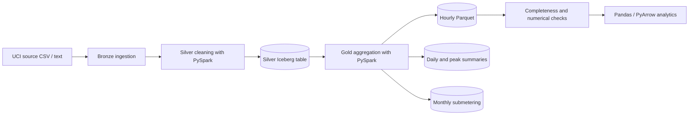
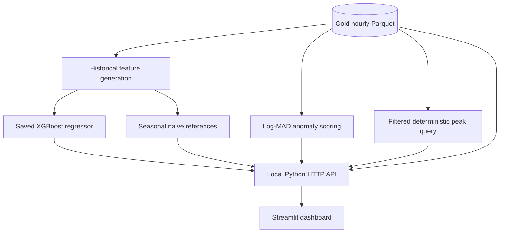
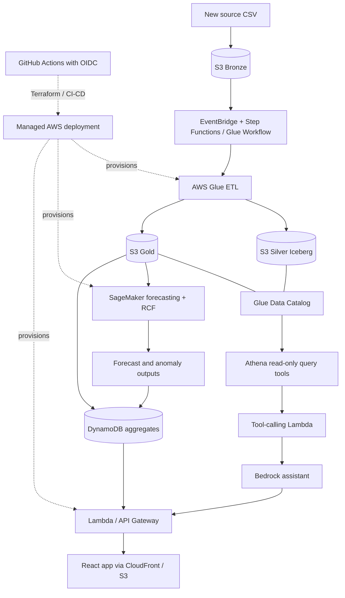

# GreenTrack — Architecture & Integration Contracts

> **Snapshot: 2 November 2026.** This document separates the verified **local data/ML/demo work** from the **shared repository integration work** and the **proposed AWS deployment**. A diagram of a future service is not evidence that it has been deployed.

[← Project README](README.md) · [Team roadmap](ROADMAP.md)

## 1. System boundaries

The project consists of several linked but independently developed parts:

- **Data engineering (A):** reproducible ingestion and Bronze → Silver → Gold lakehouse processing.
- **ML/GenAI (B):** forecast/anomaly algorithms, offline evaluation, grounded data-query foundation.
- **Application (C):** REST interface, frontend and local dependencies; future AWS deployment orchestration.
- **Shared interfaces:** `contracts/` and `fixtures/` are the agreements between these parts.

Two environments should not be conflated:

| Environment | What is established | What is not established |
| --- | --- | --- |
| **Shared GitHub repository** | Source directories, JSON contracts, core data jobs and baseline evaluation merged; DynamoDB Local Compose service; open ML and backend PRs | Fresh-clone integrated application and complete infrastructure |
| **Prepared local demonstration** (outside Git) | Gold Parquet, XGBoost/naive forecasting, local anomaly baseline, grounded peak lookup, Python HTTP API, Streamlit UI, evaluation artifacts | React app, DynamoDB-backed pipeline, managed AWS endpoints or Bedrock reasoning |

## 2. Local data lineage (executed and independently checked)

**Runtime:** the official AWS Glue 5 Docker image runs the **real Spark transformations locally**. It is not a simulated transformation and is not an AWS-hosted Glue job. Silver uses Iceberg table metadata; downstream demo analytics use an exported Gold Parquet file.

**Verified data evidence:** 2,075,259 minute-level source rows → 34,589 hourly records, of which 34,085 are complete and 504 incomplete. The Gold output was compared timestamp-by-timestamp with an independent hourly reference and had no substantive numerical mismatch.

**Data contract rules:** hourly timestamps denote hour starts and have **unspecified dataset timezone**; do not impose a timezone conversion silently. Energy values are in kWh. `minutes_recorded` represents valid reported minutes (0–60); incomplete hours must not be treated as measured full-hour totals. Downstream systems must agree on these semantics.

## 3. Local analytics and application flow

The **prepared local demo** exposes `/health`, `/consumption`, `/forecast`, `/anomalies` and a deterministic `POST /query`. The **team's target contract** includes `/chat`, which is not the same as the local typed query interface. Backend and frontend code in PRs must be checked for compatibility before merging.

**ML information boundary:** training observations are pre-2010, validation is January–May 2010, and the final reserved held-out evaluation is June–November 2010. Each 24-hour forecast may use only observations available by its forecast origin. The chosen XGBoost model was frozen before held-out testing; no test-time retraining or tuning was performed.

**Anomaly limitations:** current detector is a statistical global log-MAD baseline, **not** SageMaker Random Cut Forest. Percentile scores are not probabilities; flags do not identify fault causes. No labeled real-world anomaly-detection benchmark has been verified.

**GenAI limitations:** the peak-consumption answer is produced by validated data access and a deterministic query function. There is no implemented Bedrock model, general natural-language orchestration, Athena tool execution, Knowledge Base, or guardrails in this demo.

## 4. Target AWS architecture (proposed, not deployed)

This is a **target design**, not an inventory of services currently in use. Details such as storage layout, event source, inference mode, IAM policies, security, costs and networking must be established through Terraform and reviewed before deployment. The assignment additionally calls for Lake Formation, Glue Data Quality, SageMaker Pipeline/Model Registry, Bedrock Guardrails and S3 Vectors-backed guidance; see [ROADMAP.md](ROADMAP.md).

## 5. LOCAL → MOCK → AWS progression

| Stage | Data (A) | ML / GenAI (B) | App / DevOps (C) |
| --- | --- | --- | --- |
| **LOCAL — implemented in parts** | Glue 5 Docker + Spark transformations, Silver Iceberg, Gold exports and checks | Trained/evaluated XGBoost, naive baselines, anomaly baseline, deterministic grounded lookup | Shared API handlers in open PR; independent demo HTTP API and Streamlit running outside repo |
| **MOCK — planned/partial** | Simulated file-arrival event, S3 API stubs | Stubbed SageMaker `InvokeEndpoint` and Bedrock tool responses, documented test contracts | DynamoDB Local Compose service exists; seed/access tests and fully integrated app pending |
| **AWS — not deployed** | Terraform S3 + Glue + Athena + catalog + quality/governance/orchestration | SageMaker + Random Cut Forest + registered endpoints; Bedrock/Athena/Knowledge Base/Guardrails | HTTPS React application + Lambda/API Gateway + DynamoDB + OIDC/CI/CD |

Mocking is an **interface testing technique**, not proof that managed cloud services are deployed. For the mock stage, retain the planned React/REST contracts and Python Lambda-compatible handlers; avoid adding a second application stack solely to support emulation.

## 6. Cross-team dependencies

| Dependency | Owner → consumer | Agreed output / integration check |
| --- | --- | --- |
| Gold data → Forecasting | A → B | Hour-start timestamp, kWh fields, completeness, stable schema and missing-data policy |
| Gold data → Application | A → C | Aggregated consumption schema; coordinate anomaly response records with B |
| Forecasting and anomalies → Application | B → C | 24-hour forecast format, anomaly response shape, severity semantics, date-range rules |
| SQL tool → Assistant | A + B | Read-only parameterized query interface over approved Gold data, with bounds and source evidence |
| Assistant → Chat endpoint | B + C | Defined `/chat` inputs/outputs; distinguish deterministic lookup from Bedrock responses |
| Terraform / deployment | A + B + C | One state/backend policy, separate resource modules, least-privilege roles; C coordinates integration |

### Contract review checklist

- [ ] Confirm `contracts/consumption.json` matches actual Gold output and the application parser (`minutes_recorded`, `complete`, null values).
- [ ] Confirm whether all timestamps are naive local dataset timestamps or explicitly timezone-aware generated timestamps; no undocumented conversion.
- [ ] Confirm anomaly `anomaly_score` is a **training percentile**, not a probability; severity is `low`, `medium`, `high`.
- [ ] Decide one consistent `/forecast` response contract and 24-hour timestamp convention.
- [ ] Reconcile local `/query` with the team's `/chat` contract and define unsupported/error responses.
- [ ] Add cross-layer contract tests before claiming complete end-to-end integration.

## 7. Reproducibility and security

- Keep raw data, intermediate tables, saved models, report artifacts and local virtual environments **outside Git** unless an approved artifact strategy is in place.
- Use short-lived or identity-based AWS credentials. The target uses GitHub OIDC for CI/CD and IAM least-privilege; never commit AWS keys or secrets.
- The demo API and Streamlit services bind to `127.0.0.1`; they are development endpoints, not production authentication boundaries.
- The current root Compose service publishes DynamoDB Local on port 8000. Limit binding/firewall exposure before running on a public VPS.
- Review PR status and tests in GitHub rather than treating an independent local demo as evidence that shared main has all features.

[← Project README](README.md) · [Team roadmap](ROADMAP.md)
