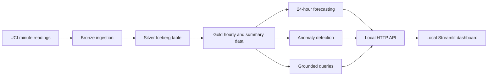

# GreenTrack — Energy Consumption Analytics & Forecasting

GreenTrack is a three-developer project that turns historical household electricity readings into **consumption analytics, 24-hour forecasts, anomaly flags, and data-grounded answers**. It is designed as an AWS-oriented data/ML application, developed **local-first** before managed cloud deployment.

**Dataset:** [UCI Individual Household Electric Power Consumption](https://archive.ics.uci.edu/dataset/235/individual+household+electric+power+consumption) · approximately 2.08 million minute-level observations, December 2006–November 2010.

> **Project status · 2 November 2026:** A verified **local integrated demo** exists outside this repository. Core data engineering code and seasonal-baseline/evaluation code are on `main`; other team features remain in PRs or a separate demonstration workspace. **The full application is not yet reproducible from a fresh clone, and no AWS cloud stack has been deployed.** See [Team roadmap](ROADMAP.md) for details.

## What GreenTrack does

| Capability | Current result | Delivery boundary |
| --- | --- | --- |
| Data engineering | Bronze ingestion, Silver Iceberg, Gold aggregates executed using the AWS Glue 5 Docker Spark runtime | Verified locally; AWS S3/Glue/Athena not deployed |
| Consumption analytics | 34,589 hourly records; 34,085 complete, 504 incomplete | Verified Gold Parquet / local demo |
| Forecasting | XGBoost 24-hour forecasts; daily and weekly seasonal-naive references | Validated locally; XGBoost PR [#7](https://github.com/remidacollaku5-dot/greentrack-gyals/pull/7) awaiting integration |
| Anomaly detection | Statistical log-MAD baseline: 18 flagged validation hours (9 low, 9 medium) | Local demo; PR [#9](https://github.com/remidacollaku5-dot/greentrack-gyals/pull/9) awaiting integration; not SageMaker Random Cut Forest |
| Grounded queries | Deterministic peak hourly consumption for an explicit date range | Local demo; not a Bedrock chatbot |
| User-facing demonstration | Local HTTP API and Streamlit dashboard, with architecture visualizations planned separately | Runs from a prepared demo workspace, **not** from a fresh repository clone |

## Architecture at a glance



This shows the **verified local prototype's logical flow**, not a deployed AWS architecture. Spark jobs produce the data separately; the demo consumes prepared outputs and saved models. See [Architecture](ARCHITECTURE.md) for the detailed local architecture, proposed AWS design, integration boundaries, and team dependencies.

## Forecasting results

The selected XGBoost configuration was frozen before one final held-out evaluation; it was **not retrained or tuned on the reserved test period**.

| Model | Validation RMSE (kWh) | Held-out test RMSE (kWh) | Test MAE (kWh) | Test WAPE |
| --- | ---: | ---: | ---: | ---: |
| **XGBoost** | **0.6232** | **0.5653** | **0.4070** | **44.19%** |
| Daily seasonal naive | 0.8818 | 0.7184 | 0.4727 | 51.33% |
| Weekly seasonal naive | 0.8721 | 0.7730 | 0.5322 | 57.78% |

Validation: **121 eligible days / 2,904 hourly targets** (January–May 2010). Held-out test: **144 eligible days / 3,456 targets**, with 34 excluded days (June–November 2010). XGBoost has the best held-out error among these evaluated candidates. A separate frozen-seasonality MSTL + SES experiment did not improve validation accuracy; an ETS experiment was suspended after state-continuity checks failed.

These are **historical, single-household** results, not claims about current live consumption or all households. Anomaly scores are training-calibrated percentiles, **not fault probabilities**; no real-world labeled anomaly benchmark has been established.

## Repository layout and ownership

```text
.
├── data/             Developer A — data engineering
├── ml/               Developer B — ML and GenAI foundations
├── app/              Developer C — application and backend
├── contracts/        Shared JSON interfaces and schemas
├── fixtures/         Example responses for integration tests
├── infra/            Terraform work area (cloud provisioning pending)
├── .github/          GitHub Actions and repository automation
├── docker-compose.yml
├── README.md
├── ARCHITECTURE.md
└── ROADMAP.md
```

| Developer | Primary responsibility | Integration responsibility |
| --- | --- | --- |
| **A — Data Engineering** (`@KLCela45`) | Challenge 2: raw → Bronze → Silver → Gold, data quality, lakehouse | Gold data schema, SQL tools, data/storage Terraform |
| **B — ML & GenAI** (`@egigj-dev`) | Challenges 3 and 4: forecasting, anomalies, grounded query foundation | Forecast/anomaly response contracts, SageMaker/Bedrock integration later |
| **C — Application & DevOps** (`@remidacollaku5-dot`) | Challenge 1: frontend, REST API, Docker, CI/CD, cloud application | Consumer of Gold/ML contracts; coordinate shared deployment |

**All three developers own their respective infrastructure modules.** C coordinates Terraform integration, rather than implementing A's and B's AWS work for them. The detailed tasks, stages, and milestones are in [ROADMAP.md](ROADMAP.md).

## How to run what is available

### 1. Fresh clone: repository scaffold and DynamoDB Local

```bash
git clone https://github.com/remidacollaku5-dot/greentrack-gyals.git
cd greentrack-gyals
docker compose config
```

The currently committed Compose configuration starts **DynamoDB Local only**, not the frontend, backend, ETL, or ML pipeline. On a trusted local development machine it can be started with:

```bash
docker compose up -d dynamodb-local
docker compose ps
docker compose down
```

**Network caution:** the current Compose file publishes port `8000:8000`. Restrict it to loopback or firewall it **before running on an Internet-facing VPS**. The Compose service is not proof that seeded tables, application integration, or end-to-end Docker startup are finished.

### 2. Prepared local demo (separate workspace)

A verified demonstration workspace was assembled on a project VPS at `~/greentrack-local-data/demo/`. **This directory and its data/model artifacts are not distributed by this repository.** On a machine where that prepared workspace already exists:

```bash
cd ~/greentrack-local-data/demo
bash run_demo.sh
```

- Dashboard: `http://127.0.0.1:8501`
- API: `http://127.0.0.1:8001`
- `Ctrl+C` stops both services.

The demo binds services to loopback. Use an SSH tunnel for remote viewing; do not expose these development services publicly. It verifies prepared artifacts at startup rather than retraining. The last local verification reported **114 passing tests** and successful API/dashboard smoke checks. See its local `HANDOFF.md` and `final_evaluation/FINAL_TECHNICAL_REPORT.md` for exact reproduction and evidence.

> **Integration task:** Package the verified components behind the team's API/contracts and make the *team application* runnable from a fresh clone. Do not copy private/local data, model files, virtual environments, or experiment output into Git without an agreed artifact strategy.

## Interfaces and collaboration

The repository's `contracts/` directory is the source of truth for shared schemas. In particular:

- `consumption.json`: hourly energy values in **kWh**, hour-start timestamp, `minutes_recorded`, and `complete` status; incomplete hours are not reliable full-hour energy measurements.
- `anomaly.json`: flagged timestamps, consumption, `anomaly_score`, and severity (`low`, `medium`, `high`). Scores are **not probabilities**.
- `chat.json`: proposed `/chat` request/response shape. The local verified query demo instead exposes a deterministic `/query` operation; these interfaces still require deliberate integration.

Key dependencies are **Gold data → ML → API → frontend**, plus joint A+B design of safe query tools and B+C alignment of assistant/chat responses. See [ARCHITECTURE.md](ARCHITECTURE.md#cross-team-dependencies).

### Contribution workflow

1. Work on an issue/feature branch; **no direct pushes to `main`**.
2. Keep scope small; run relevant tests and link the contract or fixture change if applicable.
3. Open a pull request, request at least one teammate's review, and resolve feedback.
4. Merge only after review and CI checks; coordinate stacked branches carefully.
5. Update documentation when a milestone is **verified**, not merely planned or drafted.

The original assignment calls for Terraform-managed AWS resources and GitHub Actions deployments using OIDC. Those remain future work and must not be confused with the existing basic CI checks.

## Scope and next steps

The project targets an AWS-hosted React application (S3/CloudFront or Amplify), Lambda/API Gateway, DynamoDB, S3/Glue/Athena lakehouse, SageMaker models (including Random Cut Forest), and a Bedrock assistant with safeguarded query tools. **These are planned deployment requirements, not services already running on AWS.**

The immediate priorities are to integrate reviewed data/ML/API PRs, reconcile shared contracts, make the full local team application runnable, then implement Terraform and managed AWS stages as accounts and scope allow.

See [ROADMAP.md](ROADMAP.md) for task-by-task owners and statuses and [ARCHITECTURE.md](ARCHITECTURE.md) for the local/mock/AWS progression.
