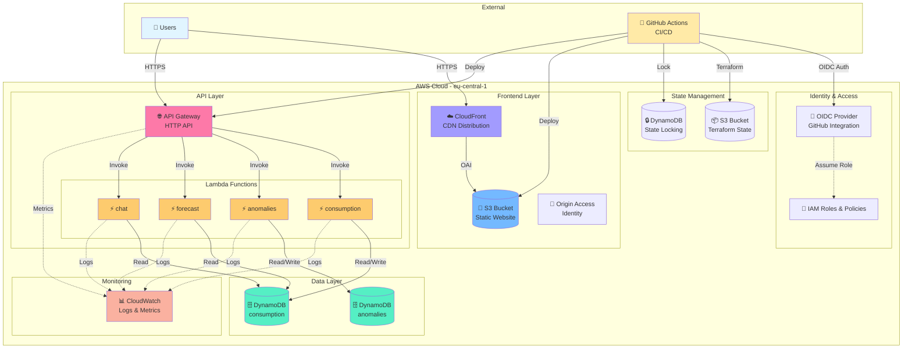
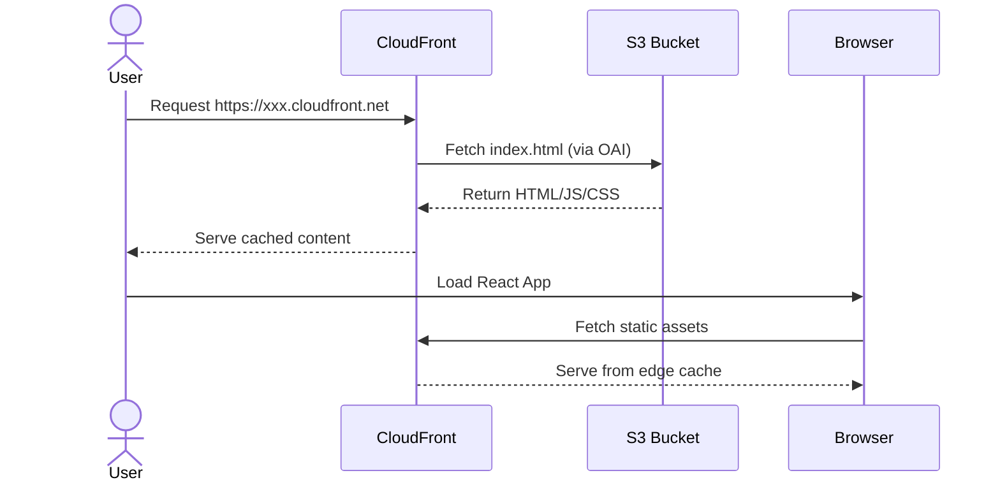
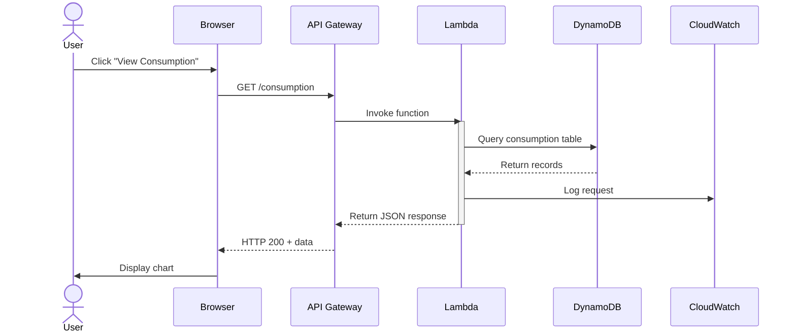
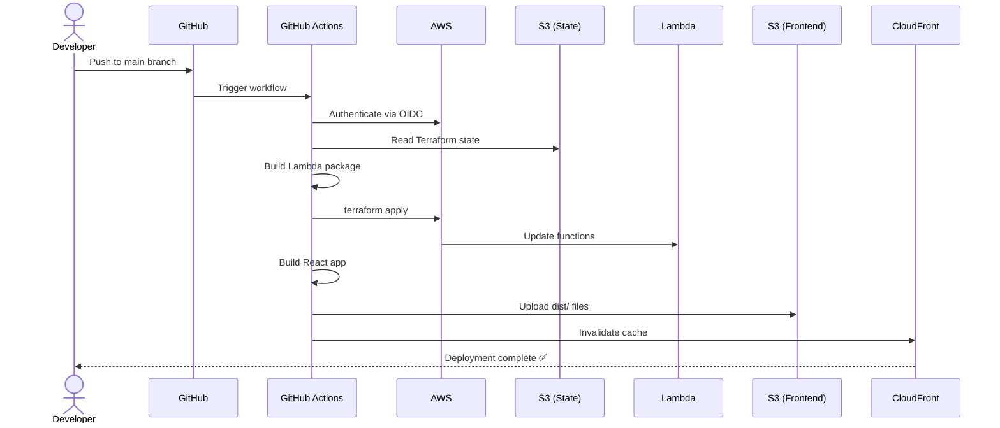
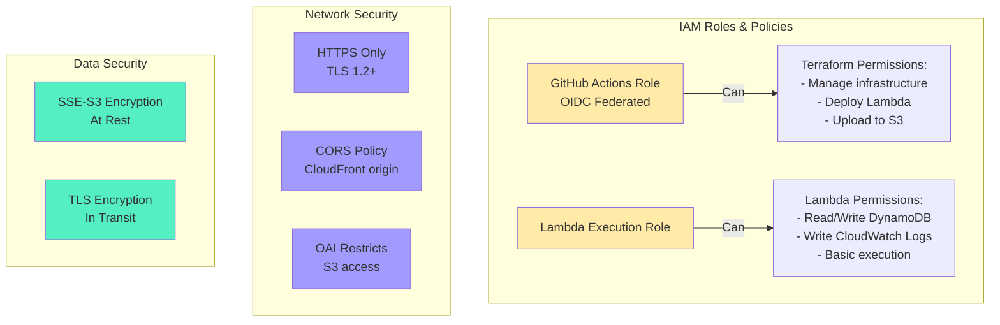
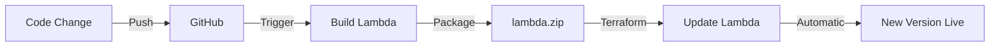
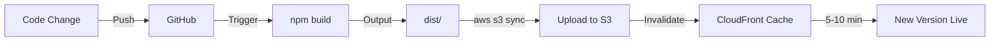
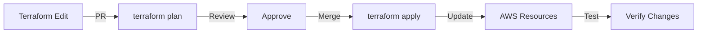
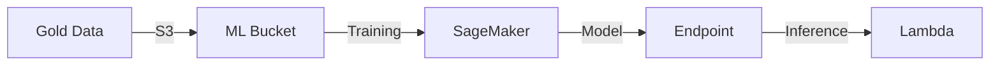
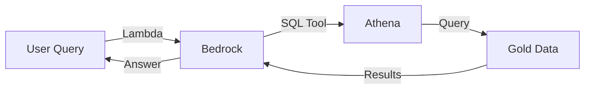

# GreenTrack AWS Architecture Diagram

## 🏗️ High-Level Architecture

---

## 🔄 Data Flow Diagrams

### 1. Frontend Request Flow

### 2. API Request Flow

### 3. Deployment Flow

---

## 📦 Resource Details

### Frontend Resources
- **S3 Bucket:** `{group_prefix}-{project}-{env}-frontend-bucket`
  - Versioning: Disabled
  - Encryption: SSE-S3
  - Public Access: Blocked (CloudFront OAI only)
  
- **CloudFront Distribution:**
  - Origin: S3 bucket via OAI
  - Cache Behavior: Default (TTL: 86400s)
  - Price Class: PriceClass_100 (US, Canada, Europe)
  - SSL: CloudFront certificate (*.cloudfront.net)

### API Resources
- **API Gateway:**
  - Type: HTTP API (v2)
  - CORS: Enabled (CloudFront origin)
  - Stage: $default (auto-deploy)
  
- **Lambda Functions:** (4 functions)
  - Runtime: Python 3.11
  - Memory: 256 MB
  - Timeout: 15 seconds
  - Package: ZIP file (~5-10 MB with dependencies)

### Data Resources
- **DynamoDB Tables:** (2 tables)
  - `consumption`: PK=household_id, SK=timestamp
  - `anomalies`: PK=household_id, SK=timestamp
  - Billing Mode: PAY_PER_REQUEST (on-demand)
  - Point-in-time Recovery: Enabled
  - Encryption: AWS managed keys

### State Management
- **S3 State Bucket:** `{group_prefix}-{project}-tfstate-{account_id}`
  - Versioning: Enabled
  - Encryption: SSE-S3
  - Lifecycle: Prevent destroy
  
- **DynamoDB Lock Table:** `{group_prefix}-{project}-terraform-locks`
  - PK: LockID (String)
  - Billing: PAY_PER_REQUEST

---

## 🔐 Security Architecture

### Security Best Practices Implemented
✅ No long-lived AWS credentials (OIDC only)  
✅ Least privilege IAM policies  
✅ Encryption at rest (S3, DynamoDB)  
✅ Encryption in transit (HTTPS/TLS)  
✅ S3 public access blocked  
✅ CloudFront Origin Access Identity  
✅ CORS restricted to CloudFront  
✅ CloudWatch logging enabled  
✅ State file encryption and versioning  

---

## 💰 Cost Breakdown

### Estimated Monthly Costs (Low Traffic)

| Service | Usage | Free Tier | Cost |
|---------|-------|-----------|------|
| **Lambda** | 1M requests, 100ms avg | 1M requests/month | ~$0.20 |
| **API Gateway** | 1M requests | 1M messages (12 months) | ~$3.50 |
| **DynamoDB** | 100k reads, 50k writes | 25 GB storage | ~$0.25 |
| **S3** | 5 GB storage + requests | 5 GB (12 months) | ~$0.15 |
| **CloudFront** | 10 GB transfer | 1 TB (12 months) | ~$1.00 |
| **CloudWatch** | Logs 1 GB | 5 GB ingestion | ~$0.50 |
| **State Storage** | S3 + DynamoDB | Covered | ~$0.05 |
| **Total** | | | **~$5-10/month** |

### Cost Optimization Tips
- Use Lambda reserved concurrency for predictable traffic
- DynamoDB on-demand is cheaper for sporadic access
- CloudFront caching reduces origin requests
- CloudWatch log retention policies (7-30 days)
- Delete old Lambda versions

---

## 🔄 Update Scenarios

### Scenario 1: Update Lambda Code

### Scenario 2: Update Frontend

### Scenario 3: Infrastructure Change

---

## 📊 Monitoring & Observability

### CloudWatch Dashboards
- API Gateway: Request count, latency, errors
- Lambda: Invocations, duration, errors, throttles
- DynamoDB: Read/write capacity, throttles

### Alarms (To Configure)
- Lambda error rate > 5%
- API Gateway 5xx errors > 10
- DynamoDB throttling events
- CloudFront 5xx error rate

### Logs Retention
- Lambda logs: 7 days (configurable)
- API Gateway logs: 7 days
- CloudTrail: 90 days (governance)

---

## 🚀 Future Enhancements

### Phase 2 (ML Integration)

### Phase 3 (GenAI)

---

**Maintained by:** Developer C (Application & DevOps)  
**Last Updated:** 2026-11-10  
**Version:** 1.0
